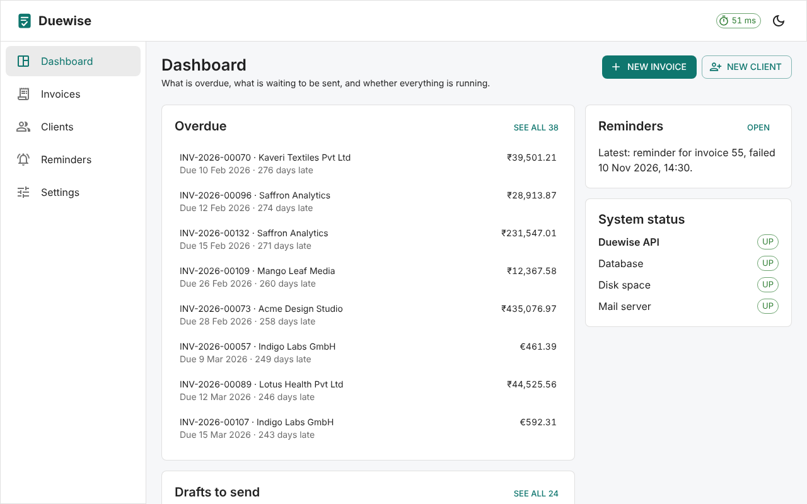
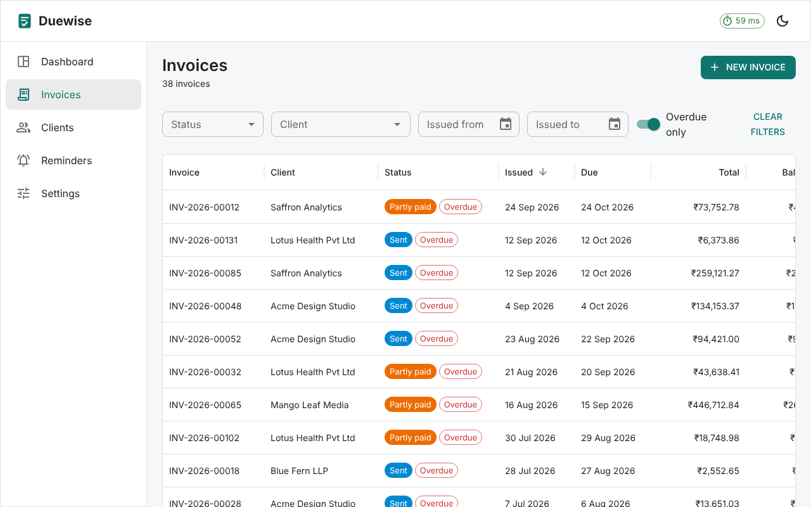
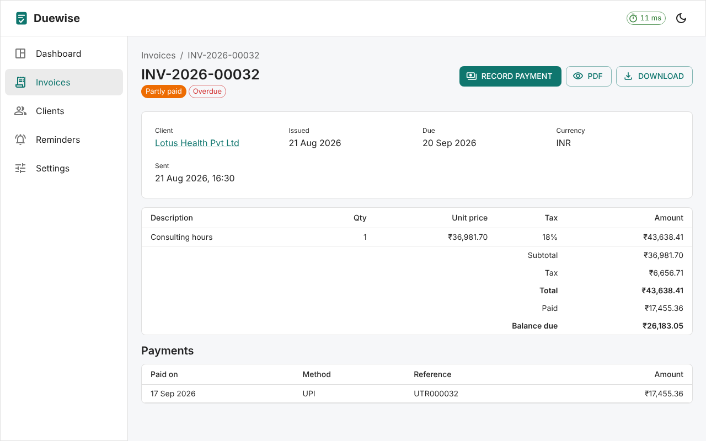
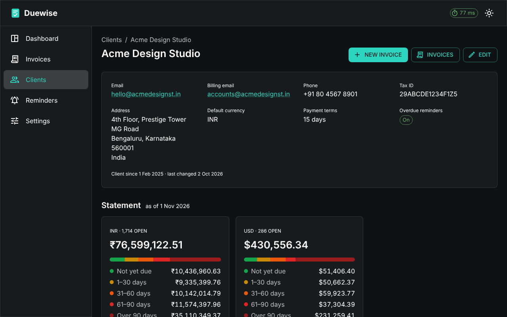

# Duewise Web

[](https://github.com/developeras95/duewise-web/actions/workflows/ci.yml)


The web app for [Duewise](https://github.com/developeras95/duewise-invoicing-api), an invoicing API
for freelancers and small businesses: clients, invoices with line items and PDF, payments, client
statements with aging, and overdue reminders.



## What it does

| Area               |                                                                                                                                                                                                                                                                                                           |
| ------------------ | --------------------------------------------------------------------------------------------------------------------------------------------------------------------------------------------------------------------------------------------------------------------------------------------------------- |
| **Clients**        | Search as you type; add and edit with Duewise's validation shown on each field; each client's statement: balances per currency split into aging buckets, and every open invoice.                                                                                                                          |
| **Invoices**       | Filter by status, client, issue dates and overdue, all kept in the address. Drafts with line items and live totals, rounded exactly as Duewise rounds. Send and email to the client with the PDF attached, void with a reason, delete drafts, record full or part payments, preview and download the PDF. |
| **Reminders**      | Turn client reminders and the daily summary on or off, choose the reminder days and summary recipients, see every reminder sent, run the job on demand.                                                                                                                                                   |
| **Settings**       | Currencies and payment methods.                                                                                                                                                                                                                                                                           |
| **Dashboard**      | Overdue invoices oldest first, drafts to send, latest reminder, system status.                                                                                                                                                                                                                            |
| **Request timing** | A badge in the top bar shows how long each call to Duewise took, as the browser saw it; click for the last 30.                                                                                                                                                                                            |

Light and dark mode, and it works on phones.

<table>
  <tr>
    <td></td>
    <td></td>
  </tr>
  <tr>
    <td colspan="2"></td>
  </tr>
</table>

## Run it

### A release, without cloning

Needs only [Docker Desktop](https://www.docker.com/products/docker-desktop/). Download
`compose.release.yaml` from the [latest release](https://github.com/developeras95/duewise-web/releases/latest), then:

```bash
docker compose -f compose.release.yaml up -d
```

and open http://localhost:3000. Emails Duewise sends land in Mailpit at http://localhost:8026.

### From this repository

```bash
docker compose up -d --build
```

| Open                                  | What                                        |
| ------------------------------------- | ------------------------------------------- |
| http://localhost:3000                 | the app                                     |
| http://localhost:3000/swagger-ui.html | the API's Swagger UI                        |
| http://localhost:8026                 | Mailpit, catching every email Duewise sends |

Both start four containers: PostgreSQL, Mailpit, the Duewise API (its released image from GitHub's
container registry) and this app, served by nginx. nginx also forwards `/api` to Duewise, so the
browser sees a single address and the API needs no CORS settings.

Stop with `docker compose down`; add `-v` to delete the database as well. Ports, the Duewise version,
real email, the business time zone and another database are set in a `.env` file: copy
[`.env.example`](.env.example) and uncomment what you need.

### Against 5 million invoices

The [performance study](https://github.com/developeras95/duewise-postgres-performance) runs a
PostgreSQL with 5 million invoices on port 5433. `.env.example` has the lines that point this app at
it, including the one that switches off the daily reminder job, which would otherwise try to remind
every one of its ~590,000 overdue invoices at once. With the request-time badge, the study's slow
queries and their fixes are visible in the screens that use them.

## Develop

Needs Node.js 22 or later, and a Duewise API: either Duewise from its own repository on
http://localhost:8080, or the one `docker compose up -d` starts (on http://localhost:8090).

```bash
npm ci
npm run dev                                        # http://localhost:5173, API on localhost:8080
DUEWISE_API_URL=http://localhost:8090 npm run dev  # use the API started by this repo's compose
```

On Windows PowerShell, set the variable first: `$env:DUEWISE_API_URL="http://localhost:8090"`.

| Command                           | What it does                                                                      |
| --------------------------------- | --------------------------------------------------------------------------------- |
| `npm run dev`                     | Development server with instant reload; forwards `/api` to Duewise                |
| `npm run build`                   | Type-checks and builds the production files into `dist/`                          |
| `npm test`                        | Unit and component tests                                                          |
| `npm run coverage`                | The same, with coverage; fails below 75% of lines or 60% of branches              |
| `npm run e2e`                     | End-to-end tests against the running stack (`docker compose up -d --build` first) |
| `npm run lint` / `npm run format` | ESLint / Prettier                                                                 |
| `npm run generate:api`            | Regenerates the API types from `openapi/duewise-api.json`                         |
| `npm run licenses`                | Regenerates `THIRD-PARTY.txt` after dependency changes                            |

### Tests

- **Unit and component tests** (Vitest, Testing Library) render screens and drive them as a user
  would. The API is replaced by [MSW](https://mswjs.io/), which answers the app's real HTTP calls,
  so the typed client, error handling and caching are tested too. Any request without a prepared
  answer fails the test.
- **End-to-end tests** (Playwright) use a real browser against the whole stack, nothing mocked:
  from a new client to a draft, a sent invoice whose email is then found in Mailpit, part and full
  payment; and Duewise's own rules (a taken
  email, a draft without lines) coming back to the right field.
- **CI** runs both on every push: first lint, formatting, tests with coverage and the build; then it
  starts the stack with Docker Compose and runs the end-to-end tests against it.

### API types

`src/api/schema.d.ts` is generated from Duewise's OpenAPI document, so every path, parameter and
response is type-checked: when Duewise's API changes, the build points at each place the app must
follow. To update it, save the document from a running Duewise and regenerate:

```bash
curl http://localhost:8080/v3/api-docs -o openapi/duewise-api.json
npm run generate:api
```

## How it is built

| Concern            | Choice                                                                                   |
| ------------------ | ---------------------------------------------------------------------------------------- |
| Language and build | TypeScript, Vite; screens load on demand                                                 |
| Components         | MUI (Material UI), light and dark mode                                                   |
| Pages              | React Router; list filters live in the address                                           |
| Server data        | TanStack Query: caching, loading and error states, refetching after changes              |
| API calls          | openapi-fetch with types generated from the OpenAPI document                             |
| Forms              | React Hook Form with Zod, mirroring Duewise's own rules                                  |
| Money              | Exact decimal arithmetic for live totals, the same rounding as Duewise                   |
| Errors             | Duewise's RFC 7807 problem details shown on the field they belong to, or with their code |
| Container          | Multi-stage build: Node builds, non-root nginx serves and proxies the API                |

```
src/
  api/          typed API client, request timing, data hooks per area
  components/   layout and shared building blocks
  lib/          formatting, exact money arithmetic, URL state
  pages/        one folder per area, with its tests
  test/         test setup, the mock API, render helper
e2e/            end-to-end tests (Playwright)
nginx/          nginx configuration used in the Docker image
openapi/        Duewise's OpenAPI document the types are generated from
```

## Releases

Each [release](https://github.com/developeras95/duewise-web/releases) publishes the Docker image
`ghcr.io/developeras95/duewise-web` and a `compose.release.yaml` pinned to that version. Changes are
listed in [CHANGELOG.md](CHANGELOG.md).

## License

Copyright © 2026 Abhijit Saha. **All rights reserved.** Published for reading and evaluation; see
[LICENSE](LICENSE). The third-party packages in the built app (MIT, BSD and ISC licensed) are listed
in [THIRD-PARTY.txt](THIRD-PARTY.txt).
